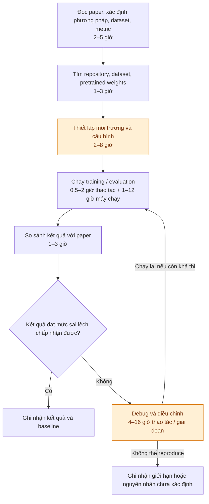
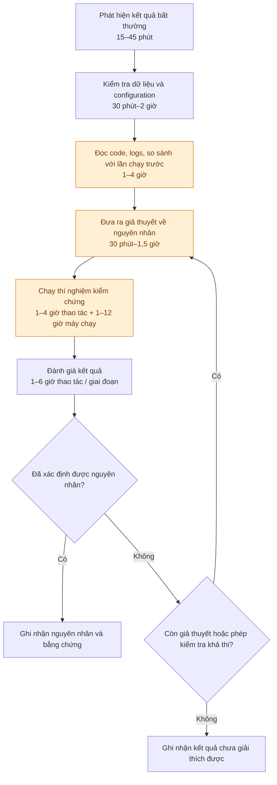
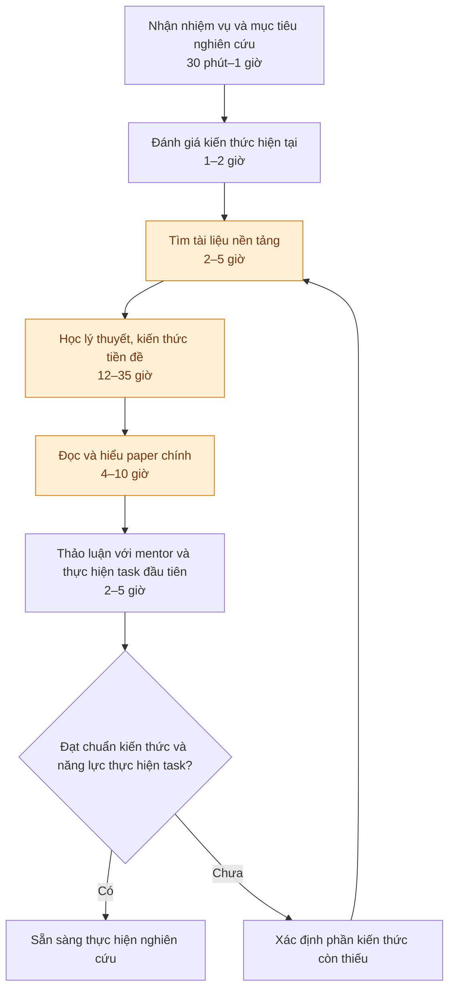

# Báo cáo cá nhân — 2A202603974_KhongNgocAnh

> Đổi tên file theo quy tắc `MSSV_HoTen.md`, ví dụ `20241234_NguyenVanAn.md` (MSSV trước, dấu `_`, họ tên viết liền không dấu). Sửa cả dòng tiêu đề phía trên cho khớp.
> Template chi tiết và prompt mẫu cho từng mục: [docs/01-worksheet.md](../../docs/01-worksheet.md).
> Mỗi thành viên một file trong `report/individual/` trên repo nhóm: copy template này thành file mới, điền, rồi commit bằng tài khoản GitHub của bạn. Không viết hộ người khác.

## 1. Thông tin học viên

- Họ tên: Khổng Ngọc Anh
- MSSV: 2A202603974
- Email trường (không bắt buộc, repo có thể để public):
- Tên nhóm: Tetris
- Link repo nhóm:

---

## 2. Scan problem (CP1)

Lăng kính: **Lặp lại** · **Tốn thời gian** · **Cần đọc, tổng hợp nhiều thông tin** · **Pain từ người khác**.

| # | Lăng kính | Job Story: Khi… tôi muốn… để… | Ai chịu ảnh hưởng? | Dấu hiệu thật (thời gian, tần suất, số người, bằng chứng) |
|---:|---|---|---|---|
| 1 | Cần đọc, tổng hợp nhiều thông tin | 	Khi cần đánh giá các tiến triển mới trong lĩnh vực mình nghiên cứu, tôi muốn xác định những kết quả quan trọng và sự khác biệt so với các nghiên cứu trước, để quyết định chủ đề nào đáng tìm hiểu sâu hơn. | RA, PhD student, PI |  |
| 2 | Tốn thời gian | Khi mới tham gia một dự án nghiên cứu chưa có kiến thức nền tảng, tôi muốn hiểu những khái niệm và công trình tiền đề cần thiết, để có thể đọc hiểu các paper chính và bắt đầu đóng góp vào dự án. | research student mới | |
| 3 | Lặp lại | Khi cần reproduce kết quả của một paper, tôi muốn tái hiện được điều kiện thí nghiệm và kết quả được báo cáo, để xác minh kết quả và có baseline đáng tin cậy cho nghiên cứu tiếp theo. | RA, research student | |
| 4 | Lặp lại | Khi thực hiện nhiều lượt thí nghiệm với các cấu hình khác nhau, tôi muốn xác định chính xác kết quả tương ứng với mỗi cấu hình và những lần chạy thất bại, để có thể so sánh các giả thuyết một cách đáng tin cậy. | RA | |
| 5 | Cần đọc, tổng hợp nhiều thông tin | Khi bắt đầu nghiên cứu một câu hỏi mới, tôi muốn xác định những công trình liên quan nhất và những hạn chế của chúng, để biết câu hỏi của mình đã được giải quyết đến đâu và xác định đóng góp nghiên cứu.| RA, PhD student | |
| 6 | Pain từ người khác | Khi tiếp nhận một dự án từ thành viên cũ của lab, tôi muốn hiểu những quyết định nghiên cứu, thí nghiệm đã thử và hạn chế đã phát hiện, để không lặp lại những công việc không cần thiết.| RA, research student mới | |
| 7 | Tốn thời gian | Khi mới được giao tiếp tục một dự án có sẵn của lab, tôi muốn hiểu cấu trúc code, dữ liệu và cách thực hiện thí nghiệm, để có thể bắt đầu làm việc mà không mất quá nhiều thời gian làm quen. | RA, research student mới | |
| 8 | Tốn thời gian | Khi một thí nghiệm không đạt kết quả mong đợi, tôi muốn xác định nguyên nhân đến từ implementation, dữ liệu hay giả thuyết nghiên cứu, để quyết định có nên tiếp tục hướng thử nghiệm đó. | RA, research student | |

**Nếu có dùng AI để gợi ý thêm:** 
- AI gợi ý thêm problem 6 7 8 

---

## 3. Top 3 Problem Cards + quy trình nháp (CP2)

### Bảng chọn top 3

| Rank | Problem | Vì sao chọn | Điều còn chưa chắc |
|---:|---|---|---|
| 1 | 3. Reproduce paper| Lặp lại, Tốn thời gian, Bước đầu tiên của mọi nghiên cứu, quy trình rõ ràng |  |
| 2 | 8. Debug kết quả nghiên cứu| Tốn thời gian | |
| 3 | 2. Xây dựng nền tảng| Tốn thời gian| Nếu mỗi sinh viên có khả năng học khác nhau thì sao |

### Problem Card #1

| Trường | Nội dung |
|---|---|
| Job Story | Khi cần reproduce kết quả của một paper, tôi muốn tái hiện được điều kiện thí nghiệm và kết quả được báo cáo, để xác minh kết quả và có baseline đáng tin cậy cho nghiên cứu tiếp theo. |
| Actor | RA, research student|
| Thời điểm / bối cảnh | Mỗi khi bắt đầu nghiên cứu |
| Quy trình hiện tại (3–7 bước) ||
| Bottleneck (bước nào, mất bao nhiêu phút) | Giả định, thiết lập môi trường, tìm |
| Impact (nếu không giải thì sao) | Chậm tiến độ nghiên cứu; không có baseline đáng tin cậy; các thí nghiệm tiếp theo có thể dựa trên implementation không chính xác. |
| Success metric (baseline → target) | thời gian để reproduce thành công một benchmark. Target đề xuất: giảm 25–30% thời gian thực hiện.  |
| Phương án không dùng AI | Checklist tái hiện thí nghiệm, môi trường và dependency được cố định, tài liệu hướng dẫn reproduce, quy trình ghi nhận configuration và kết quả |
| Giả thuyết về AI (nếu có) | AI có thể giúp xác định những thông tin về experimental setup phân tán giữa paper, supplementary material và code, hoặc nhận diện những điểm khác biệt giữa các cấu hình thí nghiệm.  |
| Cảm nhận nhanh | Workflow t |

Quy trình nháp hiện tại:

### Problem Card #2

| Trường | Nội dung |
|---|---|
| Job Story | Khi một thí nghiệm không đạt kết quả mong đợi, tôi muốn xác định nguyên nhân đến từ implementation, dữ liệu hay giả thuyết nghiên cứu, để quyết định có nên tiếp tục hướng thử nghiệm đó.|
| Actor | RA, research student |
| Thời điểm / bối cảnh | Khi mô hình không hội tụ, metric thấp bất thường, kết quả không ổn định hoặc một thay đổi trong phương pháp không mang lại cải thiện mong đợi.|
| Quy trình hiện tại (3–7 bước) | |
| Bottleneck (bước nào, mất bao nhiêu phút) | Giả định: xác định nguyên nhân trong số nhiều thành phần có thể gây lỗi. Cần đo số lần chạy thử, thời gian phân tích và thời gian xác định nguyên nhân. |
| Impact (nếu không giải thì sao) | Lãng phí tài nguyên tính toán, kéo dài thời gian thí nghiệm, đưa ra kết luận sai về phương pháp hoặc loại bỏ một giả thuyết có tiềm năng. |
| Success metric (baseline → target) | thời gian trung vị để xác định nguyên nhân gốc có bằng chứng. Target đề xuất: giảm 25%. |
| Phương án không dùng AI |  Systematic debugging, unit test, kiểm tra dữ liệu, controlled experiments, lưu lịch sử cấu hình và kết quả của các lần chạy.|
| Giả thuyết về AI (nếu có) | AI có thể hỗ trợ đối chiếu code, logs, configuration và kết quả giữa các lần chạy để đề xuất những nguyên nhân cần kiểm tra. Các nguyên nhân được đề xuất vẫn phải được kiểm chứng bằng thí nghiệm. |
| Cảm nhận nhanh |  Workflow |

Quy trình nháp hiện tại:

### Problem Card #3

| Trường | Nội dung |
|---|---|
| Job Story | Khi mới tham gia một dự án nghiên cứu chưa có kiến thức nền tảng, tôi muốn hiểu những khái niệm và công trình tiền đề cần thiết, để có thể đọc hiểu các paper chính và bắt đầu đóng góp vào dự án.  |
| Actor | New research student |
| Thời điểm / bối cảnh | Giai đoạn onboarding hoặc khi researcher chuyển sang một hướng nghiên cứu mới. |
| Quy trình hiện tại (3–7 bước) | |
| Bottleneck (bước nào, mất bao nhiêu phút) | không biết nên học kiến thức nào trước, mức độ sâu cần đạt, và gặp nhiều khái niệm phụ thuộc vào nhau khi đọc paper. |
| Impact (nếu không giải thì sao) | Thời gian onboarding kéo dài; khó hiểu yêu cầu nghiên cứu; phụ thuộc nhiều vào mentor; nguy cơ hiểu sai phương pháp hoặc giả định trong paper. |
| Success metric (baseline → target) | thời gian để đạt một ngưỡng năng lực xác định trước. Target đề xuất: giảm 20–25% thời gian với cùng chuẩn đánh giá. |
| Phương án không dùng AI | Reading list từ mentor, syllabus nội bộ, prerequisite map, study group, mentoring và các bài kiểm tra kiến thức đầu vào.|
| Giả thuyết về AI (nếu có) | |
| Cảm nhận nhanh | Workflow  |

Quy trình nháp hiện tại:

### Card muốn pitch nhất

- Card số: 
- Vì sao:
- Câu hỏi muốn nhóm phản biện:

### AI đã phản biện card thế nào

| Điểm yếu AI chỉ ra | Đồng ý? | Đã sửa gì |
|---|---|---|
| | | |

---

## 4. Tôi đã tham gia phần nào (CP3 → CP7)

| Hoạt động | Tôi đã làm gì? | Kết quả / ảnh hưởng tới bài nhóm |
|---|---|---|
| Pitch Problem Card | | |
| Phản biện bài của bạn khác | Câu hỏi tôi đã đặt: | |
| Nhận phản biện | Câu hỏi tôi nhận được: | Tôi đã sửa gì: |
| Gom cluster / cây OST | | |
| Chọn candidate problem | | |
| Kiểm chứng / research | | |
| Quy trình nhóm | | |
| Problem Statement | | |
| Mức can thiệp AI | | |
| Quyết định | | |

---

## 5. Dùng AI

| Checkpoint | Tôi dùng AI để làm gì? | AI hữu ích ở đâu? | AI sai hoặc hời hợt ở đâu? | Tôi sửa gì bằng nhận định của mình? |
|---|---|---|---|---|
| CP1 Scan | | | | |
| CP2 Problem Card | | | | |
| CP4 Research | | | | |
| CP5 Quy trình | | | | |
| CP5–6 Problem Statement | | | | |
| CP6 Mức can thiệp / quyết định | | | | |

---

## 6. Reflection (CP7)

Trả lời bằng trải nghiệm thật của bạn, tối thiểu 200 từ cho các câu 6.1–6.6 (không tính 6.7, câu này được chấm riêng ở tiêu chí C5). **Không dùng AI để viết thay.**

**6.1. Tôi học được gì khi nghe top 3 problems của các bạn khác?**

**6.2. Nhóm có lúc nào bị "solution-first" (nghĩ giải pháp trước khi hiểu vấn đề) không? Lúc đó nhóm nhận ra và xử lý thế nào?**

**6.3. Tôi có đổi ý sau khi bị phản biện không? Kể một lần cụ thể.**

**6.4. Kết quả kiểm chứng (phỏng vấn/survey/research) có làm tôi bất ngờ không? Điều gì?**

**6.5. Điều khó nhất khi viết Problem Statement là gì?**

**6.6. Nếu làm lại, tôi sẽ đổi gì? Tôi sẽ phản biện nhóm mạnh hơn ở điểm nào?**

**6.7. Hiểu bài:** giải thích bằng 5–8 câu, không nhìn tài liệu, chuỗi *problem → quy trình → metric → boundary → mức can thiệp AI → quyết định* của bài nhóm mình.

---

## 7. Tài liệu tham khảo

-
